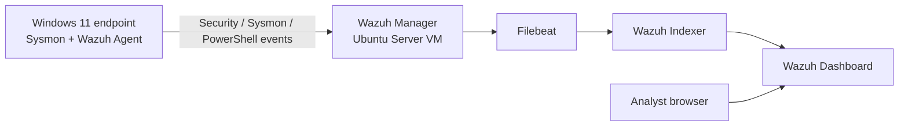

# Wazuh Mini SOC Lab — Windows Endpoint Detection & Incident Triage

A hands-on, single-manager Wazuh lab focused on Windows endpoint telemetry, SIEM detections, controlled validation, and evidence-based SOC investigations.

> **Project type:** Educational home lab. This is not a production architecture, enterprise SOC, or compliance certification.

## Objectives

- Deploy an all-in-one Wazuh server and onboard a Windows endpoint.
- Collect Windows Security, Sysmon Operational, and PowerShell Operational telemetry.
- Validate event ingestion and detection using harmless, controlled tests.
- Write and test focused Wazuh local rules.
- Validate File Integrity Monitoring (FIM), Security Configuration Assessment (SCA), and Vulnerability Detection.
- Investigate alerts through event details, command lines, parent-child process relationships, account context, Authenticode signatures, and SHA-256 hashes.
- Produce incident reports with explicit dispositions, evidence, and limitations.

## Architecture



The Wazuh server ran as an all-in-one Ubuntu Server virtual machine under VirtualBox. The Windows endpoint was separate from the VM host. The VM used NAT for outbound access and a bridged network for endpoint connectivity. Private addresses, host-specific identifiers, account names, SIDs, logon IDs, and process GUIDs have been anonymized in this public repository.

See [architecture](docs/architecture.md) and [build and validation notes](docs/lab-build-and-validation.md).

## Tested environment snapshot

| Component | Tested version / platform |
|---|---|
| Server OS | Ubuntu Server 24.04.5 LTS |
| Wazuh Manager | 4.14.9 |
| Wazuh Indexer | 2.19.6 |
| Windows endpoint | Windows 11 Home Single Language |
| Wazuh Windows agent | 4.14.9 |
| Sysmon | Sysmon Operational channel |
| Virtualization | Oracle VirtualBox |

These are recorded lab versions from November 2026, not a statement of the latest releases.

## Detection coverage

| Detection | Rule ID | Telemetry | MITRE ATT&CK | Validation |
|---|---:|---|---|---|
| `whoami.exe` execution | 100100 | Sysmon Event ID 1 | T1033 — System Owner/User Discovery | Custom alert observed |
| `ipconfig.exe` execution | 100101 | Sysmon Event ID 1 | T1016 — System Network Configuration Discovery | Custom alert observed |
| `systeminfo.exe` execution | 100102 | Sysmon Event ID 1 | T1082 — System Information Discovery | Custom alert observed |
| Marked PowerShell execution | 100103 | Sysmon Event ID 1 | T1059.001 — PowerShell | Custom alert observed |
| PowerShell spawning PowerShell | 92027 | Sysmon Event ID 1 | T1059.001 — PowerShell | Built-in alert observed |
| Scheduled-task creation | 60228 | Security Event 4698 | T1053 — Scheduled Task/Job | Built-in alert observed |
| Failed logon | 60122 | Security Event 4625 | Wazuh mapped T1531; mapping was misleading for this failed-password event | Built-in alert observed; mapping reviewed |

Wazuh rule levels are alert-rule severities, not final incident severity assessments. A detection describes observed behaviour; it does not independently prove malicious intent.

See [detection catalog](docs/detection-catalog.md) and [project-specific Wazuh rules](detections/project-local-rules.xml).

## Monitoring validation

- **Endpoint onboarding:** Windows agent enrolled and reported Active.
- **Event collection:** Windows Security, Sysmon Operational, and PowerShell Operational channels were configured and tested.
- **Custom detections:** Three discovery-command detections and one controlled PowerShell marker detection generated live Wazuh alerts.
- **Persistence telemetry:** Security Event 4698 generated Wazuh rule 60228. Task Scheduler Operational Event 106 was confirmed locally; forwarding of Event 106 to Wazuh was not proven.
- **Authentication telemetry:** A controlled failed logon generated Event 4625 and Wazuh rule 60122. The observed alert carried a misleading T1531 mapping; the case report explains the discrepancy.
- **FIM:** Create, modify, and delete operations in a dedicated test directory generated Wazuh FIM alerts. A post-restart test confirmed monitoring continued.
- **SCA:** A Windows 11 CIS benchmark assessment was run. Benchmark applicability is limited on Windows 11 Home Single Language; this is not a compliance attestation.
- **Vulnerability Detection:** The recorded point-in-time inventory showed 78 findings (0 Critical, 27 High, 41 Medium, 10 Low). Reviewed updates were not installed during this test.

## Incident investigation reports

Four controlled investigations were documented from the lab evidence and anonymized for publication:

1. [Case 001 — Scheduled Task Creation](incident-reports/case-001-scheduled-task-creation.md)
2. [Case 002 — Windows Authentication Failure](incident-reports/case-002-windows-authentication-failure.md)
3. [Case 003 — PowerShell Process Execution](incident-reports/case-003-powershell-process-execution.md)
4. [Case 004 — Windows Network Discovery](incident-reports/case-004-windows-network-discovery.md)

All four were assessed as **benign, authorized lab activity**. These reports demonstrate detection validation and triage, not confirmed malware incidents.

## Repository structure

```text
.
├── README.md
├── .gitignore
├── docs/
│   ├── architecture.md
│   ├── build-and-validation.md
│   └── detection-catalog.md
├── detections/
│   ├── README.md
│   └── project-local-rules.xml
├── incident-reports/
│   ├── case-001-scheduled-task-creation.md
│   ├── case-002-windows-authentication-failure.md
│   ├── case-003-powershell-process-execution.md
│   └── case-004-windows-network-discovery.md
└── evidence/
    └── README.md
```

## Important limitations

- This was a small home lab with one manager/indexer node and one Windows endpoint, not a distributed or high-availability SIEM.
- The SCA benchmark profile was not a formal compliance attestation for Windows 11 Home Single Language.
- The vulnerability count is a point-in-time inventory. No remediation of the reviewed CVEs was performed as part of this test.
- Task Scheduler Operational Event 106 was seen locally, but its receipt by Wazuh was not validated.
- The Wazuh T1531 mapping on the observed failed-logon event was misleading. It is documented as a detection-content quality issue rather than an analyst conclusion.
- The reports use anonymized hostnames and accounts. Raw alert archives and unredacted logs are intentionally excluded.

## Safety and privacy

All tests were performed on systems under the lab owner's control using harmless commands and temporary artifacts. No malware, credential theft, destructive payload, or unauthorized scanning was used. Do not publish raw `ossec.conf` files, credentials, enrollment keys, private keys, installation archives, raw EVTX/PCAP files, or unredacted screenshots.

## Learning workflow

**Collect telemetry → validate detections → investigate context → correlate processes and account activity → verify binaries → assess impact → document an evidence-based disposition.**
