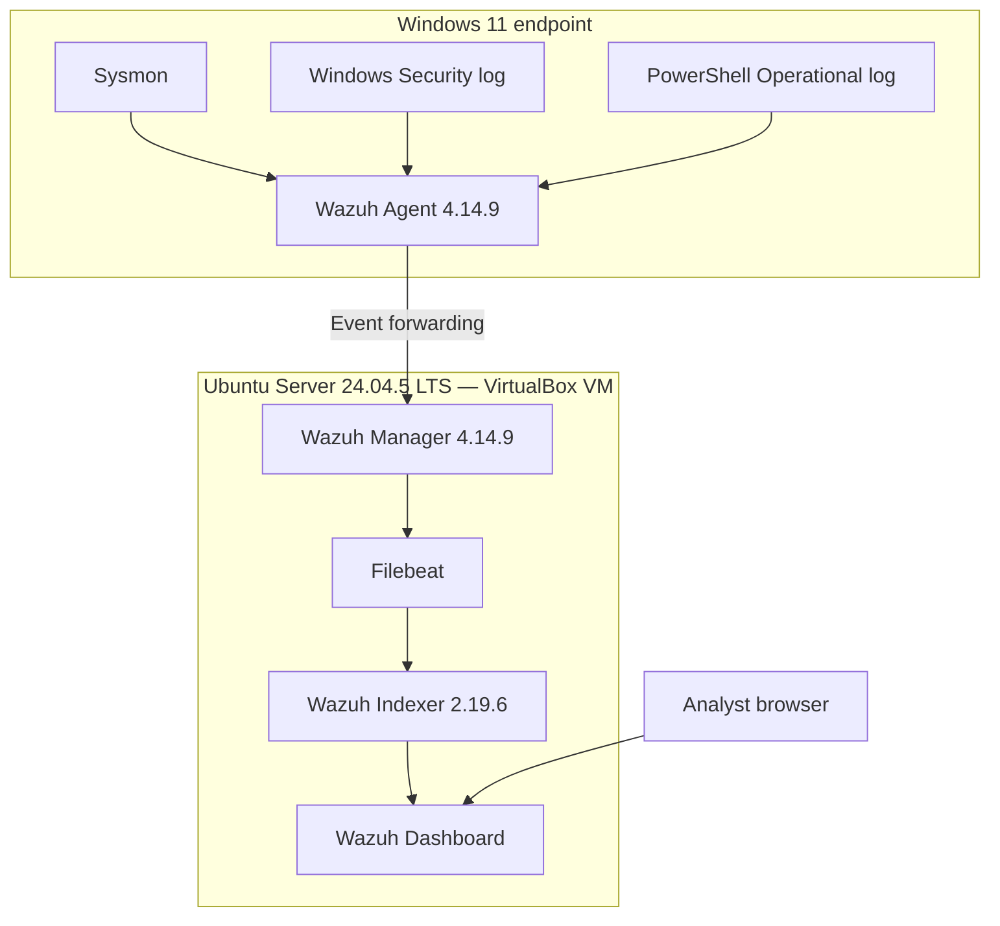

# Lab Architecture

## Topology

## Components

| Component | Role |
|---|---|
| Windows 11 endpoint | Produces process, authentication, and PowerShell telemetry. |
| Sysmon | Records process creation and other configured Windows telemetry. |
| Wazuh Agent | Collects configured Windows Event Channels and forwards events. |
| Wazuh Manager | Decodes events, applies built-in/local rules, and produces alerts. |
| Filebeat | Forwards alert data to the Indexer. |
| Wazuh Indexer | Stores and indexes event/alert data. |
| Wazuh Dashboard | Supports event search, alert review, FIM, SCA, and vulnerability views. |

## Network notes

The Ubuntu VM used NAT for outbound package access and a bridged adapter for LAN connectivity to the Windows endpoint. Public documentation omits private network addresses and host-specific identifiers. In another environment, apply firewall rules and restrict management access to trusted networks.

## Telemetry

The Windows agent collected the standard Application, Security, and System channels, plus:

- `Microsoft-Windows-Sysmon/Operational`
- `Microsoft-Windows-PowerShell/Operational`

The Task Scheduler Operational channel was enabled locally during testing. Event 106 was confirmed in the local Windows log, but Manager-side receipt was not established. Security Event 4698 was forwarded and detected by Wazuh rule 60228.

## Scope

This is a single-node learning environment. It does not include a manager/indexer cluster, high availability, dedicated log relay, enterprise identity provider, or production network segmentation.
