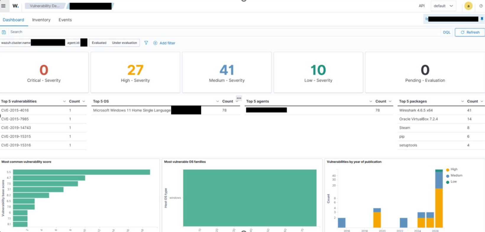
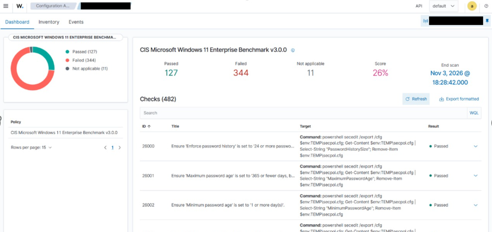
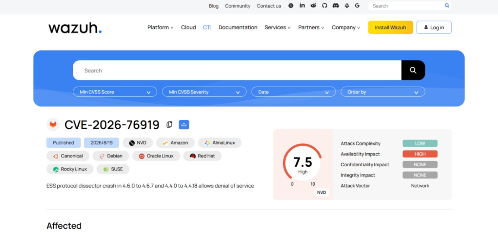
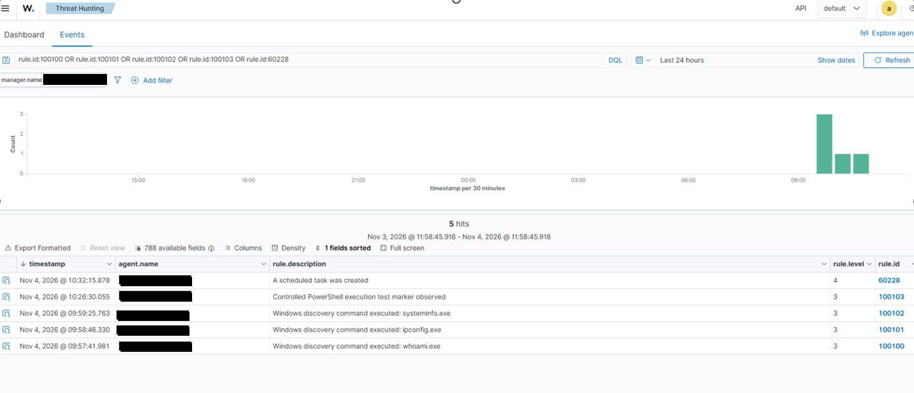

# Evidence Directory

This folder contains selected, redacted screenshots from the Wazuh lab. The images support the monitoring, validation, and investigation claims in the project documentation.

## 1. Vulnerability detection overview

**What it demonstrates:** The point-in-time vulnerability inventory for the monitored Windows endpoint. The dashboard showed 78 evaluated findings: 0 Critical, 27 High, 41 Medium, and 10 Low. This is an inventory snapshot, not proof that the findings were remediated.

## 2. Security Configuration Assessment

**What it demonstrates:** The recorded CIS Windows 11 Enterprise Benchmark v3.0.0 assessment: 482 checks, 127 passed, 344 failed, 11 not applicable, and a displayed score of 26%.

**Applicability caveat:** The endpoint was Windows 11 Home Single Language, while the selected benchmark profile was for Windows 11 Enterprise. Treat the results as an educational configuration assessment only, not a full CIS compliance claim or certification. Four selected password-policy checks were remediated and subsequently passed; the remaining failures were not all remediated.

## 3. CVE research reference

**What it demonstrates:** Supporting vulnerability-intelligence research for CVE-2026-76919, shown with a CVSS score of 7.5 (High). This reference supports the documented triage/research activity; it does not show that a patch was installed or that remediation was completed.

## 4. SIEM detection validation

**What it demonstrates:** Five Wazuh alerts from controlled Windows endpoint tests:

| Rule ID | Detection | Level |
|---:|---|---:|
| 60228 | Scheduled task created | 4 |
| 100103 | Controlled PowerShell execution test marker | 3 |
| 100102 | `systeminfo.exe` execution | 3 |
| 100101 | `ipconfig.exe` execution | 3 |
| 100100 | `whoami.exe` execution | 3 |

The events demonstrate alert generation and rule mapping. They were generated during authorized lab activity and should not be described as confirmed attacks or compromises.

## Privacy and handling

The screenshots were redacted before publication. No raw telemetry is committed here.

Never publish:

- Usernames, machine names, internal/private IP addresses, or network identifiers.
- SIDs, logon IDs, process GUIDs, or other host/session identifiers.
- Passwords, API tokens, enrollment keys, private keys, or installation archives.
- Raw EVTX/PCAP files, `alerts.json`, `archives.json`, or unredacted configuration files.

Review screenshots again before adding replacements or new evidence.
